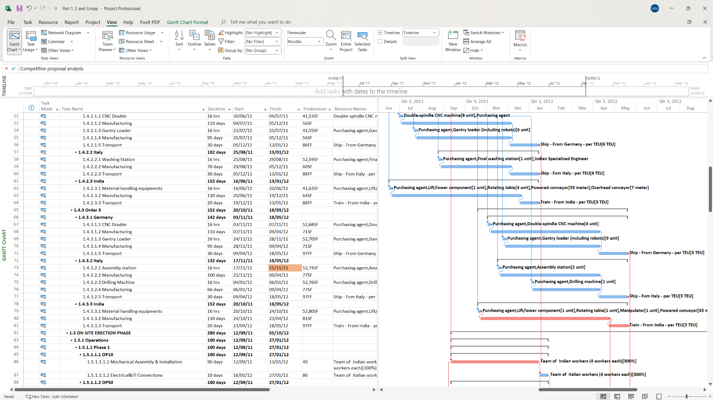
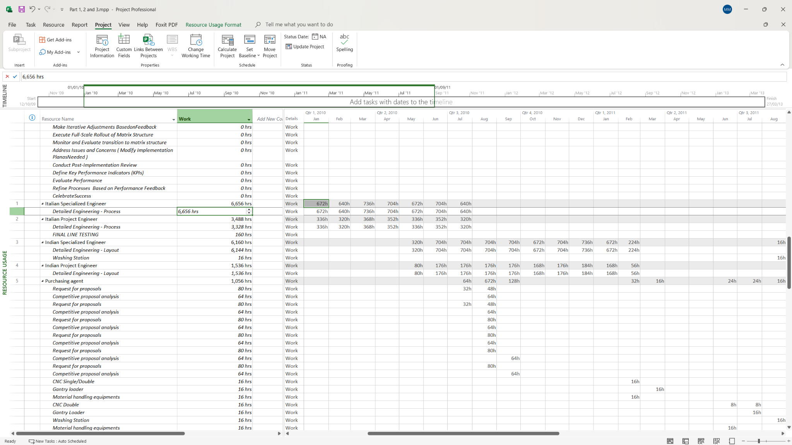
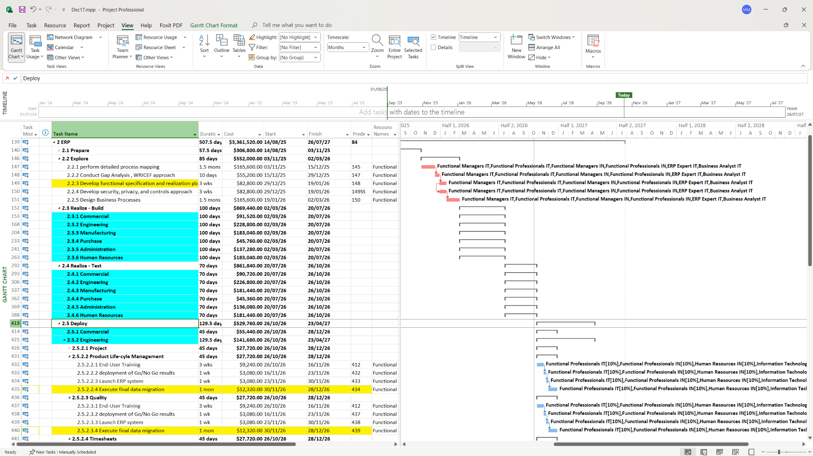

# Industrial Project Planning & Scheduling
### Integrated Manufacturing, ERP & Engineering Transformation | Microsoft Project

**An end-to-end industrial planning case study translating an international automotive expansion strategy into coordinated project schedules, resource plans, and cost estimates.**

`Microsoft Project` · `WBS` · `Project Scheduling` · `Resource Allocation` · `Cost Planning` · `ERP Implementation` · `Industrial Operations`

## Project Overview

This project explores the planning of a complex **automotive manufacturing expansion into India** for Magnus SpA, a fictional Italian automotive-components manufacturer, through a proposed joint venture with an Indian industry partner. The initiative combines the establishment of a new production line with enterprise-process modernization and engineering-organization transformation.

The central planning challenge is to coordinate **three interconnected workstreams** while accounting for activity dependencies, procurement and installation lead times, specialized resource requirements, and planned costs.

| Workstream | Planning scope |
| --- | --- |
| **Manufacturing Facility Development** | Production-line equipment, procurement, fabrication, international logistics, installation, and commissioning readiness |
| **ERP Implementation & Business Process Re-engineering** | Process mapping, solution design, configuration, testing, migration, training, and deployment planning |
| **Application Engineering Transformation** | Planning the transition toward a platform-based engineering and product-development operating model |

## 1. Manufacturing Facility Planning & Scheduling

The manufacturing workstream translates a production-line development scope into sequenced work packages. The schedule connects equipment procurement and manufacturing with shipping, on-site installation, and commissioning-related activities.



**Planning capabilities illustrated**
- **Work Breakdown Structure (WBS):** Organizing industrial deliverables into manageable activities and work packages.
- **Scheduling and dependencies:** Defining task durations, predecessor relationships, and key handoffs.
- **Procurement and logistics coordination:** Accounting for equipment manufacturing, international transport, and installation sequencing.
- **Cost visibility:** Associating planned task costs and resource assignments with scheduled work.

## 2. Resource Allocation & Capacity Planning

The resource plan translates scheduled activities into time-phased workload requirements. The **Resource Usage** view helps assess when engineering and procurement capacity is required, including roles associated with Italian and Indian operations.



**Planning capabilities illustrated**
- Assigning specialized labor resources to activities.
- Distributing planned working hours across the project timeline.
- Examining resource demand by role and period.
- Supporting coordination between project schedules and available capacity.

## 3. ERP Implementation & Business Process Re-engineering

The ERP workstream is organized around a structured implementation lifecycle: **Prepare → Explore → Realize (Build & Test) → Deploy → Run**. Its schedule integrates functional activities, milestones, dependencies, resource assignments, and planned costs.



| Phase | Key planned activities |
| --- | --- |
| **Prepare** | Project governance, master planning, requirements prioritization, resource mobilization |
| **Explore** | Business-process mapping, fit-gap analysis, functional specifications, process blueprints |
| **Realize — Build** | Technical specifications, system configuration, development, unit testing, training materials |
| **Realize — Test** | Integration testing, mock conversions, user acceptance testing, transition preparation |
| **Deploy** | End-user training, go/no-go decisions, production deployment, final data migration |
| **Run** | Post-deployment support, operational handover, project closure |

The ERP scope addresses coordination across functions such as **manufacturing, procurement, engineering, commercial operations, administration, and human resources**. The focus here is the **planning of ERP implementation**, not a claim that the software was deployed.

## 4. Engineering Transformation & Cross-Project Coordination

Alongside the facility and ERP workstreams, the expansion programme includes planning for an **application-engineering transformation**: moving toward a platform-oriented approach to product and process development. This introduces organizational and cross-functional coordination requirements into the wider programme.

The overall planning approach connects:
- **Engineering and production:** Aligning technical activities with equipment and production-line readiness.
- **ERP and business operations:** Sequencing process redesign and system implementation alongside operational requirements.
- **Resources and schedules:** Relating specialized resource demand to activity timing.
- **Costs and execution planning:** Maintaining visibility into planned costs at the task and work-package level.

## 5. Financial & Cost Planning

Financial planning is embedded in the scheduling model through **task-level planned costs and resource-related cost information**. This enables cost considerations to be evaluated alongside activity durations, resource assignments, and project sequencing.

The repository illustrates **planning and estimation**, not actual expenditure, earned-value results, or verified project savings.

## Project Planning Skills Demonstrated

**Project structuring:** Scope decomposition · WBS · Work packages · Milestones  
**Scheduling:** Gantt charts · Activity sequencing · Predecessor relationships · Cross-functional handoffs  
**Resources:** Resource assignment · Time-phased workload analysis · Capacity considerations  
**Financial planning:** Planned task costs · Resource-related costs · Cost visibility  
**Industrial planning:** Procurement · Manufacturing · International logistics · Installation  
**Transformation planning:** ERP implementation lifecycle · Business process re-engineering · Engineering transformation

## Explore the Project

The repository contains the **native Microsoft Project schedule** and three selected screenshots:

```text
Project_Planning/
├── README.md
├── Project_Planning.mpp
└── assets/
    ├── production-gantt.png
    ├── resource-usage.png
    └── erp-gantt.png
```

**[Open the Microsoft Project file](Project_Planning.mpp)** to inspect the detailed planning model in a compatible application.

---

*Project scope note: This is a planning case study built around a fictional industrial expansion scenario. It demonstrates project-planning methods and deliverables rather than claiming that the facility, ERP system, or organizational transformation was physically implemented.*
